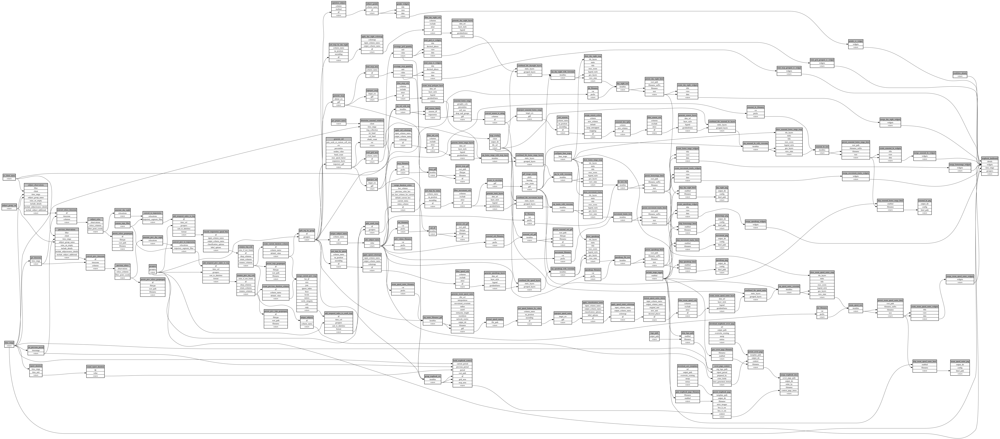

```
# AUTOGENERATED BY ECOSCOPE-WORKFLOWS; see fingerprint in README.md for details

```

```yaml
# fingerprint:
artifacts_sha256_basic: e552063a5cd63bc6d8884bca572c3721bf519c3d65846369419eee72c44002f7
artifacts_sha256_strict: 72f438b01e8386b270a14ff7e2e8e287787058725987ebec5c7aa873d65a0391
installed_requirements:
- channel: https://repo.prefix.dev/ecoscope-workflows/
  name: ecoscope-platform
  version: {version: ==2.18.0}
- channel: https://repo.prefix.dev/ecoscope-workflows-custom/
  name: ecoscope-workflows-ext-custom
  version: {version: ==0.1.0rc14}
- channel: https://repo.prefix.dev/ecoscope-workflows-custom/
  name: ecoscope-workflows-ext-ste
  version: {version: ==0.0.0rc1}
- channel: conda-forge
  name: pydeck
  version: {version: ==0.9.2}
- channel: conda-forge
  name: opentelemetry-sdk
  version: {version: ==1.45.1}
params_sha256: d8a8b68ff99c26a855eaa63b8e9c262cdcf0440f9e54db4ad86f0c93a32b1e15
spec_sha256: a0072e90734c7fcacff321a3d4e2f9c9152a6564f1d061e545b7e08e7b9c0fa8

```

# ecoscope-workflows-mapbook-report-workflow


